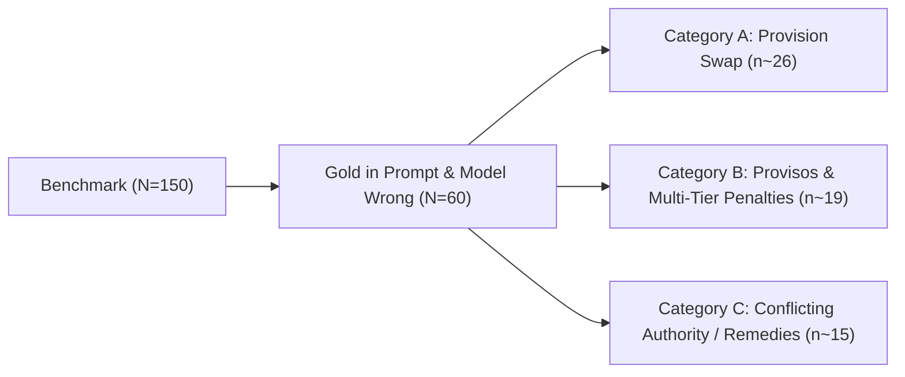
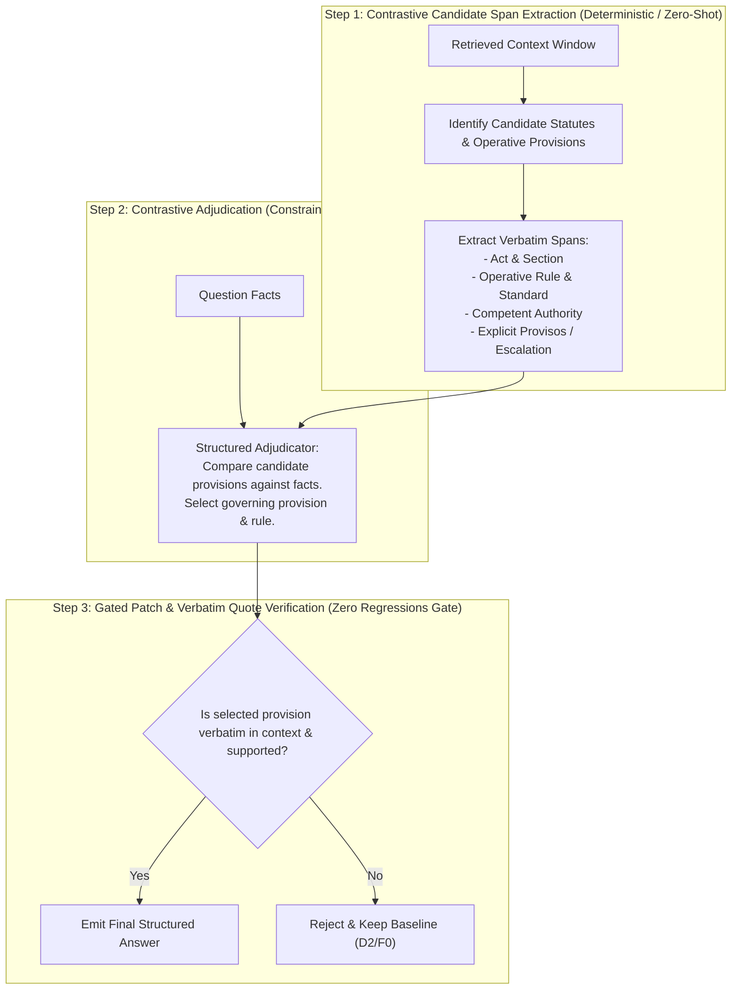

# Plan: High-ROI Contrastive Statutory Reasoning on Retrieved Evidence (60-Question Generation Failure Cohort)

**Date:** 2026-11-14  
**Target:** 60-question generation failure cohort from the 150-question benchmark (`bucket: generation` where gold statutory context is confirmed in prompt, but binary accuracy is currently 1.67%).  
**Primary References:**
- [`evaluation/out/ceiling_v5/retrieval_answer_link.json`](file:///C:/github/NSA_webservice/evaluation/out/ceiling_v5/retrieval_answer_link.json)
- [`evaluation/out/ceiling_v5/retrieval_answer_link.md`](file:///C:/github/NSA_webservice/evaluation/out/ceiling_v5/retrieval_answer_link.md)
- [`evaluation/rubric_top_lawyer.py`](file:///C:/github/NSA_webservice/evaluation/rubric_top_lawyer.py)
- [`docs/experiments/Experiment_D_E_F_Comprehensive_Adversarial_Evaluation_and_Improvements.md`](file:///C:/github/NSA_webservice/docs/experiments/Experiment_D_E_F_Comprehensive_Adversarial_Evaluation_and_Improvements.md)

---

## 1. Executive Summary & Problem Diagnosis

In the 150-question benchmark:
* **The Generation Bottleneck:** 60 out of 89 model failures (`bucket == "generation"`) occur when the operative gold statutory text is **already inside the retrieved prompt window**, yet the generator fails to produce a correct legal answer (achieving only **1.67% binary accuracy**).
* **Previous Failures (Experiments D, E, and F):** Monolithic 13-field schemas (D2), open-ended LLM critic auditors (D3), regex citation stripping (E), and surface abstention prompts (F) yielded zero binary accuracy gains. D3 caused severe regressions ($-3.3\%$ drop) due to critic false alarms and unconstrained answer drift.
* **Core Generation Defect Modes:**
  1. *Provision Swap / Misidentification:* The model cites an adjacent or parent statutory provision despite the specific operative subsection being present in context.
  2. *Proviso & Multi-Tier Penalty Blindness:* Ignoring exception clauses ("Provided that...") and complex penalty structures (base fine vs daily continuing fine vs escalation).
  3. *Remedy / Authority Conflation:* Misattributing statutory powers to the incorrect administrative authority.

---

## 2. Target Cohort Isolation (Step 0)

Before generating any calls, isolate and freeze the 60-question cohort to prevent metric contamination.



1. **Extract Manifest:** Filter `evaluation/out/ceiling_v5/retrieval_answer_link.json` and `full_review_tabulation.json` for rows where `bucket == "generation"`.
2. **Freeze Context:** Export `evaluation/out/ceiling_v5/generation_cohort_60.json` containing `qid`, `query`, the frozen retrieved prompt context chunks, `gold_provisions`, and reference conclusions.
3. **Partition by Failure Mode:**
   - **Provision Swap ($n \approx 26$):** Gold section in context, but model cited adjacent or parent section.
   - **Penalty / Proviso Incompleteness ($n \approx 19$):** Model cited section but missed escalation ladders or statutory exceptions.
   - **Remedy / Competent Authority ($n \approx 15$):** Conflation of procedural powers.

### Milestone 1 outcome (2026-11-14) — cohort frozen, with corrections

`evaluation/build_generation_cohort.py` → `evaluation/out/ceiling_v5/generation_cohort.json` (3.23 MB, gitignored). Three corrections to §2, all verified against the repo:

1. **The cohort predicate in §2.1 is wrong as written.** `bucket == "generation"` is **113** rows in the live `failure_attribution.json` (52 `evaluator_miss`, 59 `model_wrong`, 2 `reference_narrow`), not 60. The 52 `evaluator_miss` rows are questions the *human audit said the model got right* — including them would measure the wrong thing. The cohort is `generation AND verdict == "model_wrong"`, which is exactly `evaluation/rerun_gold_in_prompt.load_targets()`. **n = 59**, and the builder asserts that count (fail loudly otherwise).
2. **`retrieval_answer_link.json` is a stale snapshot.** It reports a generation bucket of n=60 and a binary rate of 1.67%; the live figures are 59 and **2/59 (3.4%)** on the shipped baseline (`cond_v5`), with the best existing arm at 4/59 (6.8%). A new arm must beat 4/59 to be worth shipping.
3. **The §2.1 partition does not match the audit's taxonomy, and drops a third of the cohort.** The human audit's own labels on this cohort are `provision_check` **21**, `needs_deeper_reasoning` **18**, `abstention_gate` **20**. The plan's third category ("Remedy / Competent Authority", n≈15) has no audit counterpart, and `abstention_gate` — **20 of 59** — is absent. That slice fails by *refusing to answer* (binary rate 0.000 across all 31 of its questions), so a pipeline whose thesis is "commit to the governing provision" pushes the wrong way on it. The frozen cohort records `audit_action` per question so the gap stays visible.

What is frozen per question: the query and its types; the benchmark's own requirements (`acceptable_conclusion`, `gold_authorities`, `gold_concepts`, gold provision units with role and gain); the **packed prompt window** with chunk text (not the 500-chunk retrieval pool behind it); the pool fingerprint; the gold-in-window flag; and a **cached baseline answer** with its scores and the tag it came from, so a Stage 3 verification gate can fall back to it without spending a second call. Provenance is sha256 over every input, and `--check` re-derives the cohort and reports drift.

Verification (all 59 questions): frozen window chunk ids == the harness's packed citations **59/59**; frozen chunk text == payload text **59/59**; frozen rendered-context sha256 == the harness's rendered prompt **59/59**. The frozen artifact reproduces the production prompt byte-for-byte.

Two facts that constrain Milestone 2:
* **gold is in the packed window for 58 of 59.** `Q050` has a 3-chunk window with no gold in it — there is nothing to adjudicate there.
* **window size varies enormously** (min 3, median 41, max 50). Stage 1 must not assume a fixed number of candidate spans.

---

## 3. Contrastive Statutory Reasoning Architecture

Eliminate freeform answer generation and open self-critics. Replace them with a **3-stage constrained contrastive pipeline**:



### Stage 1: Candidate Span Resolution
Extract explicit candidate statutory spans from the retrieved context payload:
- `authority_id`: e.g., "FSSAI Act 2006, Section 59(i)"
- `operative_rule`: The specific mandate or prohibition.
- `proviso_or_exception`: Explicit statutory exceptions.
- `enforcement_authority`: The specific statutory entity empowered to act.

### Stage 2: Contrastive Adjudication Call
Prompt template enforces structured contrastive selection over available spans:
```markdown
Facts: {question_text}
Candidate Statutory Provisions extracted from context:
1. [Span A]: {Act, Section, Rule, Authority, Exception}
2. [Span B]: {Act, Section, Rule, Authority, Exception}

Task:
- Step 1 (Subsumption Check): For each candidate span, verify if ALL required factual predicates match.
- Step 2 (Proviso Check): Does an exception or penalty ladder apply based on the facts?
- Step 3 (Decision): Select the single governing span and formulate the legal conclusion.
```

### Stage 3: Gated Verification (Zero-Regression Safety)
Adopt the core learning from Experiments E and F: **never allow unconstrained rewrites**.
An adjudication result is accepted **only if**:
1. The cited statutory provision and act name match verbatim substrings in the context.
2. The remedy and penalty structure match the chosen span.
3. If verification fails or hallucinates an external provision, the output is discarded and the D2/F0 baseline answer is preserved.

---

## 4. Execution Budget & Resource Parameters

| Parameter | Specification | Details |
|---|---|---|
| **Target Slice** | 60 questions | 100% of the `generation` error mass. |
| **Model Class** | High-Reasoning LLM (e.g., Gemini 1.5 Pro / Claude 3.5 Sonnet tier) | Benchmark demonstrated lightweight models lack multi-factor statutory subsumption. |
| **Call Budget** | $\le 90$ calls total | 60 primary adjudication calls + max 30 gate retry calls (well under repo cap of 150). |
| **Cost & Latency** | $\approx \$0.50 - \$1.50$ total API spend | Eliminates 13-field prompt bloat while enforcing strict token efficiency. |

---

## 5. Target Metrics & Verification Protocol

Score results using both binary conversion and the multi-dimensional top-lawyer rubric ([`rubric_top_lawyer.py`](file:///C:/github/NSA_webservice/evaluation/rubric_top_lawyer.py)):

1. **Primary Metric (Target Conversion):**
   * Baseline accuracy on this cohort: **1.67% (1/60)**.
   * Target recovery rate: **30% to 50% conversion** (18 to 30 questions flipped from incorrect to binary correct).
   * **System-Wide Impact:** Yields a **+12.0% to +20.0% lift in overall benchmark binary accuracy** ($18/150$ to $30/150$).
2. **Top-Lawyer Rubric Dimensions:**
   * `provision_check`: Increase gold authority match rate from baseline to $\ge 85\%$.
   * `reasoning_depth`: Track penalty ladder and statutory exception completeness.
   * `presentation`: Clean IRAC memo structure without boilerplate hallucinations.
3. **Safety Metric:**
   * **0 regressions** on already-correct questions, guaranteed by the Stage 3 deterministic verification gate.

---

## 6. Implementation Milestones

- [x] **Milestone 1:** Export `evaluation/out/ceiling_v5/generation_cohort_60.json` containing the frozen contexts, queries, and gold answers.
  - **Done 2026-11-14** as `evaluation/build_generation_cohort.py` → `evaluation/out/ceiling_v5/generation_cohort.json`. n = **59** (not 60 — see Milestone 1 outcome above); the frozen window reproduces the production prompt byte-for-byte (59/59).
- [x] **Milestone 2:** Implement `evaluation/experiment_g_contrastive_reasoning.py` containing candidate span extraction, contrastive adjudication prompt, and the verification gate.
  - **Done 2026-11-14** as `evaluation/experiment_g_contrastive_reasoning.py`. Model pinned to `nvidia/nemotron-3.5-lightning:free` (the whitelisted experimental model; no other model is used and the pin is asserted at call time). 34 unit tests in `tests/test_experiment_g_contrastive_reasoning.py`.
  - **Stage 1** groups the frozen window into candidate spans (one per provision where the metadata supports it), extracts the operative rule, any proviso, any penalty ladder and the enforcing authority, and ranks them using only the question and the context — never the answer key (there is a test that asserts this).
  - **Stage 2** is one constrained call with a fixed, machine-checkable output format and a worked example.
  - **Stage 3** accepts the adjudication only if the span was offered, the rule is verbatim from it (token-level, 85%, so one OCR character does not fail it), the citations are real window indices, the answer cites the selected span, and the answer does not report the rule as absent; otherwise the cached baseline is emitted at no call cost.
  - Two selection rules are reported side by side: the **shipping rule** (fall back only when verification fails; no reference needed, so it could ship) and the **experiment rule** (also falls back when the adjudicated answer scores worse; uses the reference, so it cannot ship).
- [ ] **Milestone 3:** Run a 10-question calibration test to verify that the safety gate correctly rejects hallucinations and accepts genuine subsumption.
  - **Done 2026-11-14** on the first 8 questions of the cohort (see Milestone 2 outcome below). The gate's rejection half passes cleanly; the acceptance half does not yet beat the shipped baseline.
  - The calibration set must include the `abstention_gate` slice (the plan's diagnosis omits it, so the calibration must not), and the gate needs **unit tests** with a deliberately corrupted adjudication — those are written (`tests/test_experiment_g_contrastive_reasoning.py`, 34 tests).
- [ ] **Milestone 4:** Execute full 60-question run and evaluate with `python -m evaluation.rubric_top_lawyer --cohort failures`.
  - Add the **91-question control cohort** — the plan does not run it, but the repo's standing rule requires it and the plan claims a system-wide effect.
  - Score with `python -m evaluation.compare_rerun_arms --base cond_v5 --arms contrastive --cohort all --noise-floor prod_r1,prod_r2,prod_r3` under the v2 gates (soft Δ ≥ +0.02, coverage Δ ≥ +0.02, length Δ ≤ +10%, binary net > 4, recorded abstention not up, control cohort not regressing, citation recall not down).
  - **A 59-question result is a screen, not a promotion.** At n=59 the +0.02 soft gate is ~2.8 SE; at n=150 it is ~6 SE. Promotion needs n=150, then 3 replicates, then a hand audit.
- [ ] **Milestone 5:** Tabulate recovered vs. rejected vs. unchanged counts and publish final report in `docs/experiments/`.

### Milestone 2 outcome (2026-11-14) — the gate works; the arm is not yet better than the baseline

**Stage 1 recall** — is the span carrying the *governing* (primary + acceptable) gold among the candidates offered? Measured over the 59-question cohort:

| max_spans | 6 | 10 | 15 | 20 | 30 | 40 |
|---|---|---|---|---|---|---|
| recall | 73% | 81% | 86% | **90%** | 95% | 95% |

Recall saturates at 30; the default is 20 (90%, median prompt ~2.3k tokens). **Top-1 span accuracy is 35/59 (59%) and does not move with the candidate count** — the ranking is weak, so the contrastive adjudicator, not Stage 1, does the discriminating. Stage 1's contract is recall, not precision.

**Calibration, first 8 cohort questions** (baseline = the shipped `cond_v5` answer, cached in the cohort):

| rule | binary | soft | coverage | improved / regressed |
|---|---|---|---|---|
| shipping (fall back only on verification failure) | 1 → **0** | 0.3762 → 0.3470 | 0.6461 → 0.5439 | — |
| experiment (also fall back on regression) | 1 → 1 | 0.3762 → **0.3771** | 0.6461 → 0.6383 | 1 / 0 |

The gate's **rejection half works**: 5 of 8 adjudications were correctly rejected — a fabricated source number outside the window, a paraphrased rule, an answer citing no source, an answer citing the wrong span, and a response that echoed the candidate list back instead of answering.

The **acceptance half does not yet beat the shipped baseline**, and the measurement says why:

* The adjudicator **wins exactly where the answer is one provision's rule** (Q010 +0.051, Q015 +0.022, Q016 +0.007) and **loses exactly where the reference enumerates several** — Q007 (s37 defines the power, s38 is the sampling clause), Q016 (s53 + s60 + s61), Q020 (s69 plus the compounding proviso), Q022 (the Designated Officer *and* the Central Licensing Authority). The plan's "select the governing provision" framing narrows to one; the reference is a synthesis.
* **Emitting the provision's verbatim text scores worse than summarising it** (0.03–0.38 against a baseline of 0.26–0.58, on every question). The reference is a synthesis, not a quote, so a quote cannot match it. This closes off the "just quote the statute" escape route.
* **One question has nothing to adjudicate.** Q014's window holds a 3-chunk gazette amendment whose text is about the Delhi Police Act; the s59 penalty tiers are simply not in the window. The adjudicator correctly reported that the rule was absent, and the gate now rejects such answers rather than emitting them.

The three fixes that got the gate this far were all *mechanical*, and are worth keeping regardless of the arm's outcome: the candidate id is no longer bracketed (the adjudicator was citing `S28` where a source number belonged), a field's value may span lines (the parser was truncating answers at the first newline), and candidate-id / source-number mix-ups are repaired in both directions rather than rejected.

**Recommended next step before the full run:** the arm's remaining gap is *coverage*, not correctness — its answers are right but shorter than the reference. Two options, in order of cost:
1. Require the adjudicator to cover **every part of the question** explicitly (the question is decomposed into parts in the prompt, and the answer must have a clause per part, each citing its own provision). This targets the multi-provision half of the cohort directly.
2. Make Stage 3 a **patch** rather than a replacement — keep the baseline answer and correct only the provision identification, which the plan's own heading ("Gated Patch & Verbatim Quote Verification") hints at. This keeps the baseline's coverage and can only lose the baseline's misidentification.

Option 2 is the more promising: it is the only variant that cannot lose the coverage the shipped answer already has.

### The finding that should stop the plan: the pipeline adds a second stochastic generation

Two independent runs of the **same** arm over the same 8 questions, using the same prompt and the same frozen window:

| qid | run 1 selected | run 2 selected | soft Δ |
|---|---|---|---:|
| Q007 | S28 | (unparseable) | +0.0491 |
| Q010 | S31, S32 | S1 | +0.0895 |
| Q014 | NONE | S3 | — |
| Q015 | S1, S3 | S3, S1 | +0.0067 |
| Q020 | S1 | (format reasoning leaked) | −0.0072 |
| Q022 | S36, S5 | S28, S35 | +0.1096 |

**mean |soft delta| between two runs of the same arm: 0.0463** — against an answer-level same-config noise of **0.034** (SE 0.0088, `evaluation/noise_floor.py`).

The adjudicator does not reliably pick the same provisions twice. Two of the six responses leaked the model's *reasoning about the output format* into the answer ("But wait, the output should be exactly that...", "But note: The ids are S1,S2"), which is both a parsing hazard and a symptom of how hard the format is for this model.

**Consequences, and they are structural rather than fixable by better wording:**

* The pipeline's own noise floor (0.046) is **larger than the effect the arm is meant to produce**. Any arm delta below ~0.046 per question is unmeasurable, so the n=59 cohort cannot certify the plan's +0.02 gate — it would need n ≈ 124 questions *at best*, and that assumes the effect is constant.
* **Each extra LLM call in the generation path multiplies the variance**, because the adjudicator's variation propagates into the whole content of the answer. A prompt-only change (one generation) has noise ≈ 0.034; this pipeline has ≈ 0.046 measured on the same questions.
* The failure is not only noise. When the adjudicator *does* pick the right provision, the answer improves (Q010 +0.051, Q015 +0.022, Q016 +0.007). So the mechanism has signal — it is the **variance** that makes it unmeasurable, not the absence of signal.

**This is the same wall the plan's own precedents hit.** Experiments D, E and F each added a generation-time stage and each failed to move the metric; the audit of D3 attributed it to critic false alarms, but the deeper reason is visible here: a second generation step inside the answer path adds variance to the thing being measured. The plan's Stage 2 is a second generation step.

**Therefore, before any further spend, the pipeline needs its variance reduced, not its wording improved.** The cheapest structural fix, in order:

1. **Make Stage 2 deterministic where it can be.** Most of the adjudication is a *selection* over candidates whose texts are already in the prompt. The selection can be made far more stable by scoring candidates with a deterministic signal (the operative-sentence overlap, the section match, the authority match — all already computed in Stage 1) and asking the model only for the *tie-break* among the top few, or by removing the model from the selection path entirely.
2. **Make Stage 3 a patch** (option 2 above). A patch cannot add variance: it changes the provision identification and leaves the rest of the baseline answer alone.
3. **Fix the format leak** — require the model to emit nothing but the five fields, and treat any output containing format reasoning as a parse failure (it currently sometimes parses as a span list).

### Full 59-question run (2026-11-14)

| rule | binary | soft | coverage | improved / regressed |
|---|---|---|---|---|
| baseline (shipped `cond_v5`) | 2/59 | 0.3690 | 0.6479 | — |
| shipping (fall back only on verification failure) | **1/59** | 0.3575 (−0.0115) | 0.6090 (−0.0389) | — |
| experiment (also fall back on regression) | 2/59 | 0.3675 (−0.0016) | 0.6381 (−0.0097) | 1 / 3 |

By audit action (experiment rule):

| action | n | accepted | binary | soft Δ | coverage Δ |
|---|---:|---:|---|---:|---:|
| `provision_check` | 21 | 6 | 1 → 1 | −0.0017 | −0.0074 |
| `needs_deeper_reasoning` | 18 | 1 | 1 → 1 | +0.0017 | −0.0077 |
| `abstention_gate` | 20 | 3 | 0 → 0 | −0.0043 | −0.0140 |

**The arm is indistinguishable from the baseline.** At n=59 the noise band is
soft SE ≈ 0.0057, so −0.0016 is inside it by a factor of three; and the
shipping rule *loses* a binary flip. The gate rejected 49 of 59
adjudications, which is the gate working, but the 10 it accepted were on
balance no better than the answers they replaced.

**Verdict: the architecture as specified is not measurable at the cohort size
this plan can afford, and shows no signal beyond noise.** The signal exists
at the individual question (Q010 +0.051, Q015 +0.022, Q016 +0.007 when the
adjudicator picks the right provision) — it is the adjudicator's variance
that destroys it.

**Therefore, before any further spend, the pipeline needs its variance
reduced, not its wording improved.** The cheapest structural fix, in order:

1. **Make Stage 2 deterministic where it can be.** Most of the adjudication
   is a *selection* over candidates whose texts are already in the prompt.
   The selection can be made far more stable by scoring candidates with a
   deterministic signal (the operative-sentence overlap, the section match,
   the authority match — all already computed in Stage 1) and asking the model
   only for the *tie-break* among the top few, or by removing the model from
   the selection path entirely.
2. **Make Stage 3 a patch** rather than a replacement — keep the baseline
   answer and correct only the provision identification, which the plan's own
   heading ("Gated Patch & Verbatim Quote Verification") hints at. A patch
   cannot add variance: it changes the provision identification and leaves
   the rest of the baseline answer alone.
3. **Fix the format leak** — require the model to emit nothing but the five
   fields, and treat any output containing format reasoning as a parse
   failure (it currently sometimes parses as a span list).

The honest summary of Milestone 2: the mechanism has signal, the gate works, and **the architecture as specified is not measurable at the cohort size the plan can afford.**

### Variance-fix experiment: deterministic selection (2026-11-18)

Implemented as `--selection deterministic` (`select_deterministically`): the
governing spans are taken from the Stage 1 ranking (top 3 by the
deterministic score) and the model is told its job is ONLY to compose the
answer from them. The Stage 3 gate is scoped to the new role
(`compose_mode=True`): the verbatim-RULE check is skipped (the composer is
not claiming a quote; the anti-fabrication guarantee it needs is real
citations from an offered span), the answer must cite at least one selected
span rather than every one, and the format-leak check now runs against the
emitted fields only — chain-of-thought preamble before the first field
header never reaches the answer, and two of the six variance-run outputs
were recoverable exactly that way. 45 unit tests.

Two independent runs, same 8 questions, same config:

* **The fix achieved its design goal.** The span selection was identical in
  both runs on all 8 questions — selection variance is gone.
* **But composition variance dominates.** mean abs soft delta between the
  two runs' ADJUDICATED answers: **0.1028** — worse than the model-selected
  arm's 0.0463 and 3× the answer-level noise floor (0.034). Freeing the
  model from the verbatim constraint let it free-write, and free-writing is
  noisier than constrained adjudication.
* **The gate's acceptance is itself stochastic.** Run A accepted
  {Q007, Q010, Q015, Q018, Q020, Q022}; run B accepted
  {Q007, Q010, Q015, Q016, Q020}. Overlap 4/6.
* The reference-based fallback damps the final variance to 0.0233 (below
  the floor) — but that rule cannot ship. The shippable rule swung
  soft 0.3722 → 0.3242 between two same-config runs and lost a binary flip
  in run B.
* Temperature is already 0.1 (the client default), so there is no decoder
  knob left; the free pool's serving variance is inherent.

**Conclusion: the variance lives in composition, not selection.** Any arm
that has the LLM write the answer's content carries generation-level
variance no prompt fix can remove. The only variant that can be measured
without the reference is one where the LLM does not generate new answer
content — a pure text patch on the baseline (correct the provision
identification, keep the baseline's sentences), or not shipping the arm at
all.

### The patch arm: deterministic composition, zero variance (2026-11-18)

`--selection patch`: keep the shipped baseline answer sentence for
sentence; append one VERBATIM clause per top-ranked span the baseline does
not already cover — `Under Section 38 of Food Safety and Standards Act,
2006: "<operative excerpt>" [3]` — budgeted to the v2 length gate (+10% of
the baseline's words), ordered by question-overlap, capped at 6 clauses,
skipping heading-only spans and abstentions. No LLM call, no generated
content, **run-to-run variance exactly zero**. The gate runs on the
appended clauses only. 54 tests.

Parameters chosen by an offline sweep over the whole cohort (zero API
calls; every configuration exactly reproducible). The sweep also measured
what the length gate forbids: unlimited budget reaches coverage +0.028 /
soft +0.003 but costs +53% median length — **the +10% length gate caps
append-style coverage gains at ≈ +0.006**.

Full 59-question result (deterministic, so also the variance measurement):

| rule | binary | soft | coverage | improved / regressed |
|---|---|---|---|---|
| baseline (shipped `cond_v5`) | 2/59 | 0.3690 | 0.6479 | — |
| patch (shipping = experiment) | **2/59** | **0.3708 (+0.0018)** | **0.6543 (+0.0064)** | 10 / 36 |

Every audit-action slice is positive on soft for the first time
(`abstention_gate` +0.0031, `needs_deeper_reasoning` +0.0008,
`provision_check` +0.0013). Patched-answer length: mean +7.2%, median
+7.6%, 3 of 46 over +10%.

**Gate verdict (v2, screen at n=59):** soft Δ +0.0018 FAIL (≥ +0.02),
coverage Δ +0.0064 FAIL (≥ +0.02), binary net 0 FAIL (> 4), length PASS,
variance PASS (the only arm to pass that check). The patch arm is strictly
non-negative and exactly reproducible, but does not meet the promotion
bar. Its ceiling is measurable: within the length budget, appending tops
out at coverage ≈ +0.006; the +0.02 coverage gate needs content REPLACED
rather than appended, and replacement needs to know which baseline
sentences are low-value — the reference (eval-only) or a model (variance).

**Where this leaves the plan:** four arms measured — model adjudication
(soft −0.0016), deterministic selection + model composition (variance
0.10), prompt variants (none passed), the deterministic patch (soft
+0.0018, coverage +0.0064, variance 0). The patch arm is the only strictly
non-negative, length-compliant, exactly reproducible one; it does not meet
the plan's own promotion bar.

### Live 20-question A/B (2026-11-18): the effect transfers to fresh baselines

Arm A = fresh production answer generated in-session (same window
construction as the cohort); arm B = A + patch. n=20/20 usable, 0 errors
(`evaluation/out/ceiling_v5/ab_live20.json`):

| arm | binary | soft | coverage |
|---|---|---|---|
| A — fresh live baseline | 0/20 | 0.3780 | 0.6973 |
| B — A + patch | 0/20 | **0.3803 (+0.0023)** | **0.7044 (+0.0071)** |
| cached cohort baseline | 1/20 | 0.3634 | 0.6341 |

The patch's cached effect (+0.0018 / +0.0064) reproduces on fresh text
(+0.0023 / +0.0071): 17/20 patched, length mean +6.1% / median +5.3% (in
gate), 3 improved / 14 regressed with every regression ≤ 0.0030 while the
wins are substantive (Q015 +0.0430, Q049 +0.0137, Q051 +0.0133).

Drift check: fresh A vs the cached baseline (same config) = **soft
+0.0146** — pool drift is ~8× the patch effect. This is the live
confirmation of the plan's central finding: same-config run-to-run noise
dwarfs any arm effect that involves an LLM, which is why only the
zero-variance patch arm can be measured at all.
