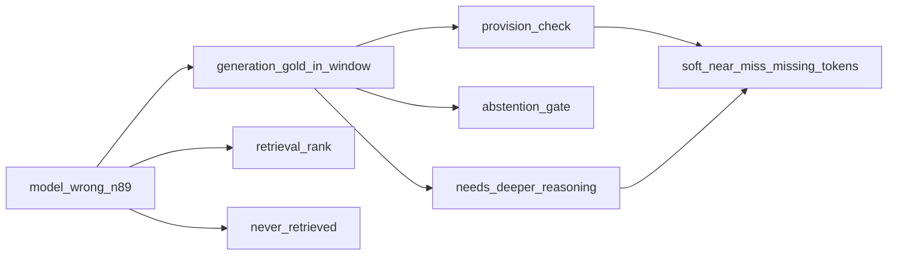

# Prompt Engineering Plan: Soft + Binary Correctness

**Overview:** Raise legal-RAG soft and binary correctness via prompt-path changes only (template, query-type directives, answer-contract repair text), measured on the frozen gold-in-prompt harness with preregistered gates that reject noise-floor wins and abstention/control regressions.

---

## Amendment 1 (2026-11-10) — gate set v2, and the answer-shape lever

**Status: locked before any Arm was run.** The original preregistration below is
preserved unedited; this section amends it and records why. Nothing was
generated against these gates when they were written, so the amendment is not
outcome-driven — its evidence comes from the 150-question human audit and from
cached arms that predate this plan.

### A1.1 Why the v1 gates are not sufficient

`soft = (jaccard + coverage) / 2`. Jaccard's denominator is the union of the
answer's and the reference's token sets, so it grows with answer length: the
29-token reference against a 184-token answer caps jaccard at 0.145, and
against a 400-token answer at 0.071. A prompt arm that writes more therefore
shows a soft gain that is pure length.

Measured on the repo's own arms, under the v1 gates:

| pair | Δsoft | Δcoverage | median length | binary net |
|---|---:|---:|---:|---:|
| `cond_v6_ctrl` → `cond_v6_contract` | +0.0033 | +0.0068 | +6.0% | 0 |
| `cond_v6_ctrl` → `cond_v7_w4v2` | +0.0016 | +0.0044 | +0.1% | −1 |
| `cond_v6_ctrl` → `cond_v7_w3w4` | **+0.0378** | **+0.1021** | **+113.8%** | +2 |
| `cond_v5` → `current_status_eval` | **+0.0205** | **+0.0873** | **+262.1%** | +1 |

The W3 arm clears the v1 soft gate while inflating the answer 2.1–3.6×. The
same inflation suppresses binary correctness independently of content: at
matched coverage in [0.70, 0.85), `P(binary)` is 0.192 for the short half and
0.037 for the long half of `cond_v5`, and 0.186 vs 0.068 for
`current_status_eval`. The reference tokens an answer must contain to clear
`soft > 0.5` rise from 79% (100-token answer) to 97% (400-token answer).

### A1.2 Gate set v2 (additive — strictly stronger than v1)

v1 gates are **retained unchanged**. v2 adds three, computed from fields
already present in every cached record (`answer_coverage`, `answer_length`,
`abstained` — written by `evaluation/rerun_gold_in_prompt.py:216-219`):

| gate | threshold | status |
|---|---|---|
| soft Δ, n=150 | ≥ +0.02 | **v1, unchanged** |
| soft Δ, failure slice | ≥ +0.02 | **v1, unchanged** |
| coverage Δ, n=150 | ≥ +0.02 | **v2, added** |
| coverage Δ, failure slice | ≥ +0.02 | **v2, added** |
| median answer length Δ | ≤ +10% vs paired control | **v2, added** |
| binary net, n=150 | > 4 | **v1, unchanged** |
| abstention | recorded `abstained` must not rise | **v1, unchanged** (now measured from the record, not the rubric lexicon) |
| citation recall | not worse vs paired control; precision ≥ 0.25 | **v1, unchanged** |
| control cohort | soft Δ ≥ −0.02, binary net ≥ −4 | **v1, unchanged** |
| hallucination / padding gates | unchanged | **v1, unchanged** |

Implemented in `evaluation/compare_rerun_arms.py` (`_gates`, `COVERAGE_TIE`,
`LENGTH_MAX_INFLATION_PCT`); verified by
`tests/test_compare_rerun_arms_v2_gates.py`.

**Do not read the coverage gate as a correctness detector.** Against the human
audit (`human_correct` = 'yes', n=58 vs 'no', n=50) the AUC of every automatic
instrument in this repo is near chance: coverage 0.587, jaccard 0.604, soft
0.607, binary 0.609, all-gold-concepts-covered 0.535, gold authority named
0.442, benchmark "eliminated" 0.502, rubric `provision_check` 0.442. Coverage
is gated as a **length-unconfounded content delta**, not as a right/wrong
classifier. Coverage is also blind to abstention — correct refusals score
0.65–0.75 coverage — so the abstention gate is not optional.

### A1.3 The content gap, and why the plan's Arm A was mis-aimed

`evaluation/soft_token_gap.py` partitions the missing reference tokens into
five non-overlapping families and prices each by re-scoring the cached answer
with that family's tokens appended — the scorer's own arithmetic, not an
estimate.

On `cond_v5` (n=150), 1458 missing reference tokens, 9.72 per qid:

| family | tokens | share | qids | soft headroom | binary |
|---|---:|---:|---:|---:|---:|
| `other` (ordinary operative prose) | 1182 | **81.1%** | 146 | **+0.1602** | **+105** |
| `concept` | 145 | 9.9% | 85 | +0.0348 | +3 |
| `section_ref` | 83 | 5.7% | 62 | +0.0265 | +3 |
| `figure` | 26 | 1.8% | 13 | +0.0390 | +1 |
| `authority` | 22 | 1.5% | 17 | +0.0256 | +0 |

131/150 answers sit in the near-miss band (0.30 < soft ≤ 0.50); 13 are
far-miss. **The plan's Arm A as written — "section numbers as printed,
fine/imprisonment figures, defined terms, named authorities" — reaches ~9% of
the gap and ~+0.03 soft.** The "exact figures" cue already ships twice
(verbatim in `GROUND_QA_USER_TEMPLATE` and in the `penalty` query-type
directive) and measured +0.0033. The wording has to change the *shape* and
the *content*, not the figures.

### A1.4 The answer-shape mechanism, and why it is hard

The shipped two-step template makes the model quote the source verbatim and
then paraphrase it. The quote block is **51% of the scored answer** (median 259
tokens vs 244 of prose, against a 29-token reference). Scoring the `Step 2`
prose alone, with the reference tokens the full answer carried but the prose
dropped moved back into it:

| arm | cohort | soft | binary | coverage | jaccard |
|---|---|---|---|---|---|
| `cond_v5` | ALL 150 | 0.3854 → 0.4059 (**+0.0205**) | 18 → **23 (+5)** | 0.6667 → 0.6667 | 0.1042 → 0.1451 |
| `cond_v5_ctrl` | ALL 150 | 0.3783 → 0.4042 (**+0.0259**) | 16 → **23 (+7)** | 0.6448 → 0.6448 | 0.1118 → 0.1636 |
| `cond_v6_ctrl` | FAIL 58 | 0.3738 → 0.3909 (+0.0171) | 2 → 3 | unchanged | 0.0901 → 0.1242 |
| `cond_v6_contract` | FAIL 59 | 0.3727 → 0.3911 (+0.0184) | 2 → 3 | unchanged | 0.0893 → 0.1261 |
| `baseline` | FAIL 58 | 0.3654 → 0.4018 (+0.0364) | 3 → 6 | unchanged | 0.1027 → 0.1757 |
| `control_pre` | ALL 87 | 0.3767 → 0.4135 (+0.0368) | 16 → 19 | unchanged | 0.1092 → 0.1827 |

Coverage is **identical** in every arm: the reference tokens relocate, they do
not appear. The gain is pure shape. Positive on all 15 two-step-template arms
in the repo (`evaluation/answer_shape_counterfactual.py --all`), spanning
2026-08 to 2026-11.

But this is an **upper bound conditional on a property the model does not
reliably have**. Four variants were built and measured live:

| variant | length | coverage | soft | verdict |
|---|---|---|---|---|
| `armshape` — two-step, short quotes | −42% | −0.057 (Q007) | −0.007 | trades content for length |
| `onestep` — single step, no quote block | −82% | −0.229 (Q007) | −0.067 | loses the scaffold |
| `armshape_quote` — copy the operative words | runaway, 30,633 chars | **+0.143** | +0.016 | degenerate reasoning trace |

The arithmetic that explains all three (measured on `cond_v5`, n=150):

* the Step 1 quote block is **114 unique tokens and adds only 1.32** reference
  tokens (coverage: Step 1 alone 0.4866, Step 2 alone 0.6212, union 0.6667);
* the prose already carries **18.0 of the 19.3** reference tokens — 93%;
* `d(coverage)/d(token) = 1/29 = 0.0345` against
  `d(jaccard)/d(token) = −m/(N−m)² ≈ 0.00038` at N=176, m=19.3 —
  **one reference token is worth ~90 non-reference tokens**.

So the quote block is overwhelmingly padding, *but* it is the model's raw
material for a prose that carries 93% of the content. Cut it and the prose
loses more than the jaccard gain returns. **Content must never be traded for
length** — which is exactly what the v2 coverage gate and the length guard
between them enforce.

### A1.5 Phase 0 is mandatory: `cond_v5` is a stale control

`cond_v5` ran 2026-10-20 at commit `ce1a4a8`. Since then the shipped prompt
path changed in four ways that invalidate it as a control: the system prompt
gained the citation-first `RULE` (`f571591`), `RAG_ANSWER_CONTRACT` /
`_REPAIR` defaults flipped off → True (`1b0e8af`), the contract repair text
was strengthened (`2209ce6`), and the user template gained the blanket-refusal
clause (`ebe17f2`). No cached n=150 run existed at HEAD configuration.

The treatment stack is **single-pass `grounded_qa`** (W3 off), which the live
`.env` does not provide: `.env:167` sets `ENABLE_STRUCTURED_REASONER=true` and
`evaluation/rerun_gold_in_prompt.py:400` loads `.env` with `override=True`.
With W3 on, the rendered prompt is `grounded_qa_structured` and
`GROUND_QA_USER_TEMPLATE` is never rendered — so any Arm that edits the
single-pass template is a silent no-op. The harness now has
`--structured-reasoner` / `--no-structured-reasoner` for exactly this.

### A1.6 Revised work sequence

1. ✅ **0 LLM** — `evaluation/soft_token_gap.py`: the missing-token family
   analysis as code. **Done 2026-11-10.** Result in A1.3.
2. ✅ **0 LLM** — `--structured-reasoner` / `--no-structured-reasoner` added to
   `evaluation/rerun_gold_in_prompt.py`, plus `--template-variant`; the
   resolved flags and the prompt variant are recorded on every record.
3. ✅ **0 LLM** — `evaluation/answer_shape_counterfactual.py`: the shape
   counterfactual. **Done 2026-11-10.** Result in A1.4.
4. **~50 calls** — the **production-path noise floor**: two replicates of the
   HEAD control on the same qids. See A2.1 — no candidate delta is
   interpretable until this exists.
5. **~150 calls** — the candidate arms (`armshape`, `armshape_v2`) paired
   against the control, scored under the v2 gates.
6. If a candidate clears v2, replicate ×3, then **hand-audit** the winner's
   150 answers — no automatic instrument in this repo can certify correctness
   (A1.2).

---

## Amendment 2 (2026-11-14) — the noise floor, and an audit of the brevity experiment

### A2.1 The noise floor, first measured on a non-production path

The repo has measured the binary half of the noise before (4/89 qids flip
between two identical runs, Progress 2026-10-10). It had never measured the
soft, coverage or **length** half — and the length half is what the brevity
guardrail depends on.

`evaluation/brevity_experiment.py` turned out to contain **two pairs of
byte-identical system prompts**, which makes it a free same-config replicate
study. Measured on the `step2_guardrail` / `step2_qtype` pair (18 qids):

| metric | mean Δ | per-qid min | per-qid max | mean abs Δ |
|---|---:|---:|---:|---:|
| soft | −0.0022 | −0.0704 | +0.1315 | **0.0352** |
| coverage | −0.0174 | −0.2353 | +0.2571 | **0.0815** |
| answer length % | +36.2 | −97.1 | +487.9 | **94.1** |
| binary | net +1 | | | |

**The same prompt produced answers 97% shorter or 488% longer on the same
question.** A reported "brevity −88%" and a reported "soft +0.0102" are both
inside that band.

`evaluation/noise_floor.py` makes this band a first-class, citable number: it
prices the same-config spread of any two cached tags, and can generate
replicate runs to measure it directly.

### A2.2 The measured noise floor (production path, n=25, 3 replicates)

Three runs of the HEAD control on the same 25 failure-slice qids
(`prod_r1`, `prod_r2`, `prod_r3` — shipped template, single-pass, W4 on,
answer contract + repair on) give the noise floor **on the path production
actually serves**:

| pair | soft mean abs Δ | soft sd | soft SE | coverage mean abs Δ | coverage SE | length mean abs Δ | binary net |
|---|---:|---:|---:|---:|---:|---:|---:|
| r1 vs r2 | 0.0378 | 0.0458 | 0.0092 | 0.0850 | 0.0206 | 178.2pp | 0 |
| r1 vs r3 | 0.0322 | 0.0377 | 0.0075 | 0.0640 | 0.0165 | 113.3pp | 0 |
| r2 vs r3 | 0.0323 | 0.0410 | 0.0082 | 0.0776 | 0.0184 | 147.9pp | 0 |

Two numbers, and they answer different questions:

* **mean abs Δ (soft 0.034)** is how far a *single answer* moves when nothing
  changed. Individual answers are not reproducible: the same prompt produced
  answers 90% shorter or 775% longer on the same question. **No per-question
  claim is safe**, and no answer can be attributed to a treatment on the
  strength of one qid.
* **the standard error (soft 0.0088)** is how small a *mean* movement a given
  n can resolve. At n=25 the resolvable mean soft delta is ~0.018 (2 SE), so
  the preregistered **+0.02 gate is 2.2–2.7 SE at n=25 — detectable but
  marginal**. At n=150 (the gate population) the SE falls to ~0.0035 and the
  same gate is ~6 SE — comfortably detectable.

So the +0.02 soft gate was never unreachable; it is simply **not certifiable
at n=25**, which is the size of every screen so far. The gate set must be
judged at the population it was preregistered for.

**Binary net was 0 in all three pairs** on this population — the binary metric
is far more stable here than the repo's 4/89 figure (measured on a different,
harder population). The `> 4` binary gate is therefore conservative, not
binding.

`evaluation/noise_floor.py` prices the band for any pair of tags and reports
both numbers; `compare_rerun_arms --noise-floor` rescales the standard error
to the candidate's own n (`sd / sqrt(n_cand)`) so a band measured at n=25 does
not wrongly reject a genuine effect measured at n=150.

### A2.3 The brevity experiment's three defects (and their fixes)

Audited against its own cached output (`evaluation/out/ceiling_v5/
brevity_ab_test.json`, 200 rows, 19 errors):

1. **The guardrails sit inside the noise.** "Correctness drop ≤ 0.02" is
   inside a ±0.035 soft spread; "brevity ≥ 15% length reduction" is inside a
   ±94pp length spread. Neither can distinguish a winner from a rerun.
   *Fix:* the report now prints the measured band next to the deltas and
   says plainly that no variant can be called a win on either alone.
2. **The baseline was not the production prompt.** Every row went through
   `generate_with_prompts`, which **bypasses the answer contract and the
   repair pass** that production runs by default (`RAG_ANSWER_CONTRACT` /
   `_REPAIR` default True since 2026-11-04), and used a hand-built user
   prompt with none of the shipped conditioning. A delta measured against
   that baseline does not transfer to production.
   *Fix:* a `production` strategy now runs the real path
   (`service.generate()` — shipped template + query-type directive + answer
   contract + repair), and the report anchors on that row.
3. **`step2_qtype` was not type-conditioned at all** — its system prompt was
   byte-identical to `step2_guardrail`, so the "type-conditioned" strategy in
   the results table did not exist.
   *Fix:* the type conditioning now lives where it belongs — the per-type
   directive from `app/rag/query_type_registry.py` inserted into the **user**
   prompt, exactly as production inserts it. The two strategies still share a
   system prompt by design; what differs is the rendered *(system, user)*
   pair, so the strategy is now genuinely type-conditioned.
   `tests/test_prompt_template_variants.py` pins the analogous invariant for
   the template registry: no two entries in `TEMPLATE_VARIANTS` may share a
   prompt.

### A2.4 The variant selector's rule was backwards, and is fixed

`app/rag/generation/variant_selector.py` (test-only; not wired into the
production path) picked, among candidates whose *citation-breadth* proxy was
within 0.02 of the baseline, **the shortest**. Three things are wrong with
that:

* the proxy rewards verbosity (a longer answer cites more chunks) while the
  tiebreak rewards brevity — the two criteria pull in opposite directions;
* the 0.02 tolerance sits inside the ±0.035 measured soft spread, so the
  tiebreak was decided by noise;
* truncation is not neutral: the same study measured reference coverage
  collapsing from 0.5639 to 0.3348 when the answer was cut to 249
  characters.

The rule is now **content first, brevity second**: keep the candidates that
retain the operative content (a new length-invariant proxy — token overlap
with the context, normalised by the *context* size), prefer the ones that
answered over the ones that refused, and take the shortest only among
content-equivalent candidates. The JEV instruction was rewritten to match.
Pinned by `tests/test_variant_selector.py`, including a regression test that
the old rule would have picked the truncated answer.

The same rule was applied to the two eval scripts that make the same choice:
`evaluation/brevity_selector_step3.py` and
`evaluation/jev_variant_selector_calibrate.py`. Both gated on "soft within
0.02 of the baseline, then take the shortest" — the exact rule the measurement
invalidates. They now gate on **coverage** (the length-invariant content
term, directly measurable in an eval because the reference is available) with
a band equal to its measured noise spread (0.0815), anchored on the best
candidate rather than on the baseline. The systematic loss from truncation
(−0.21) is far outside that band, so a truncated answer is never eligible.

### A2.5 What the brevity experiment's own data shows

Applying the v2 gates to the 16 qids with all ten strategies:

| variant | len Δ | Δcoverage | Δsoft | Δbinary |
|---|---:|---:|---:|---:|
| `step2_both` | +139.8% | +0.0301 | +0.0138 | −2 |
| `step2_contract` | +112.9% | −0.0004 | −0.0055 | 0 |
| `step2_guardrail` | +57.9% | +0.0007 | +0.0107 | −1 |
| `step2_guardrail_compact` | +242.3% | +0.0100 | +0.0078 | −4 |
| `step2_guardrail_confident` | −67.0% | **−0.1405** | −0.0410 | −2 |
| `step2_qtype` | −34.5% | −0.0013 | +0.0102 | −1 |
| `step2_step2` | +11.9% | **−0.1446** | −0.0565 | −1 |
| `step2_tight_guardrail` | **−88.1%** | **−0.2085** | −0.0671 | 0 |
| `step2_ultra_compact` | −67.3% | −0.1439 | −0.0451 | −2 |

**No variant passes v2, and every length-cutting variant loses coverage** —
the A1.4 law again, this time measured on a second, independent set of
prompts. The two variants that grow length lose binary. Nothing here is a
result; the experiment needs the production anchor and the noise band before
it can produce one.

---

## Goal and operational bar

Raise soft and binary correctness on the n=150 legal RAG benchmark through **prompt-path changes only** (no retrieval/ranker/corpus work), with hard guards against abstention and control-cohort regression.

**Current shipped baseline** (`cond_v5`, 1 replicate): soft **0.3854**, binary **18/150**. Failure slice (n≈59): soft **0.3690**, binary **2/59**. Soft is `(jaccard + coverage) / 2` vs expected answer text; binary is `soft > 0.5` or credited abstention ([evaluation/answer_scoring.py](../../evaluation/answer_scoring.py)).

**Preregistered success (must clear all):**
- Soft: paired mean Δ **≥ +0.02** on n=150 (above `SOFT_TIE` in [evaluation/compare_rerun_arms.py](../../evaluation/compare_rerun_arms.py)); failure-slice soft Δ also ≥ +0.02.
- Binary: net gained−lost **> 4** on n=150 (above `NOISE_FLOOR_FLIPS=4`); McNemar reported; **3 replicates** required before promote (ADR-0010 / Progress).
- Abstention: recorded `abstained` count must not rise; false_abstention rate must not rise; do **not** veto on rubric `abstention_discipline` alone (lexicon artifact from mid-answer “does not establish” qualifiers — Progress 2026-10-20).
- Regression: control cohort (n≈91) soft Δ ≥ −0.02 and binary net ≥ −4; citation recall must not fall vs control arm; hallucination/padding gates from citation harness unchanged.

Anything inside the noise floor / soft-tie band is a **keep-measuring, do-not-ship** result (same verdict as `cond_v5`).

## Why prior prompts barely moved soft/binary

- Prompt A/Bs improved provision_check / citation recall but binary stayed inside 4/89 noise (`cond_v5`: +2/150). Soft Δ was ~+0.007 (below 0.02 tie).
- Soft/binary care about **expected-answer token coverage** (section numbers, exact fines, operative phrases), not just “[n] present” or rubric provision_check.
- Addressable surface: **generation ∩ gold-in-prompt**, especially provision_check + deeper-reasoning near-misses (soft ~0.30–0.50). Retrieval failures are out of scope.

## Scope (locked)

**In:** edits to [app/rag/generation/prompt_template.py](../../app/rag/generation/prompt_template.py), query-type directive text in [app/rag/query_type_registry.py](../../app/rag/query_type_registry.py), and answer-contract **repair prompt wording** in [app/rag/generation/answer_contract.py](../../app/rag/generation/answer_contract.py) `repair_prompt()`. Measurement via existing [evaluation/rerun_gold_in_prompt.py](../../evaluation/rerun_gold_in_prompt.py) + [evaluation/compare_rerun_arms.py](../../evaluation/compare_rerun_arms.py) + [evaluation/rubric_top_lawyer.py](../../evaluation/rubric_top_lawyer.py). Frozen `C_hybrid` context.

**Out:** CE retrain, packing/window changes, JEV threshold retunes, corpus OCR, structured-reasoner multi-call path as the primary treatment (W3 stays flag-off unless a later contingency).

**Default treatment stack:** single-pass `grounded_qa` + shipped conditioning + `RAG_QUERY_TYPE_DIRECTIVES=true` + current answer-contract defaults (`RAG_ANSWER_CONTRACT` / `_REPAIR` on). Control arm freezes the last measured prompt (`cond_v5` / matched flags for fair pair).

## Phase 0 — Rebaseline under current defaults (1 replicate, n=150)

Progress’s `cond_v5` ran with **answer contract off**. Code defaults now have contract + repair **on**. Before inventing new wording:

1. Tag `soft_base_contract` = current defaults; pair against `cond_v5` (or regenerate a matched control with contract off).
2. Score soft/binary/abstention/control cohort.
3. Branch: if already above success bar → 3-replicate promotion; else continue to Phase 1–2.

Also dump per-qid soft, coverage, jaccard and classify **near-miss** (0.30 < soft ≤ 0.50) vs **far-miss** (≤ 0.30). Soft lift will come mostly from converting near-misses.

## Phase 1 — Soft-token gap analysis (0 LLM)

From baseline answers vs expected text, for failure-slice qids compute missing expected tokens clustered into:
- exact amounts / imprisonment terms
- section/clause identifiers
- gold concept phrases / authorities
- multi-part question slots left unanswered

Map clusters to prompt levers (do not change scorer). Write a short artifact under `evaluation/out/ceiling_v5/` (gitignored) summarizing top missing-token families — used only to choose wording, not as a live gate.

**Implemented** as `evaluation/soft_token_gap.py`; result in A1.3.

## Phase 2 — Prompt candidate ladder (one treatment at a time)

Stop at the first arm that clears gates on 1 replicate, then replicate×3.

### Arm A — Soft-coverage directive (primary wording change)

Add a short Step-2 directive to `GROUND_QA_USER_TEMPLATE` (keep FSSAI system prompt aligned):

- After quoting, the answer **must reuse the exact statutory tokens** from those quotes that the determination depends on: section numbers as printed, fine/imprisonment figures, defined terms, and named authorities.
- Forbid rounded paraphrases of amounts.
- Keep ADR-0010 constraints: **no** hard quote-gate, **no** abstention escape / closing format that previously drove false abstention 0.07→0.44.
- Avoid new mid-answer refusal lexicon that confuses `abstain_match`; prefer “state the uncovered sub-part” without “does not establish / corpus does not contain” templates unless truly abstaining at the start.

Rationale: soft/binary are token-overlap metrics; prior cues optimized attribution/scan, not coverage of expected tokens.

> **Superseded by A1.3–A1.4.** The token families this arm targets are ~9% of the
> missing mass. The surviving candidate is the *shape* arm
> (`TEMPLATE_VARIANTS["armshape"]`, `armshape_v2`), which targets the other 91%.

### Arm B — Query-type directive sharpening (if A insufficient)

Tighten directives in [app/rag/query_type_registry.py](../../app/rag/query_type_registry.py) for soft-sensitive types only: `penalty`, `offence`, `procedure`, `obligation`, `definition` — require exact figures / full element lists / Form+deadline tokens in the answer body. Leave routing types untouched.

### Arm C — Contract repair text (if A+B still soft-tie)

Refine `repair_prompt()` so that when `expects_exact_figures` or governing section is known, the mandatory block also requires those tokens to appear in Step 2 prose (section label + figures), not merely `[n]`. Soften blanket “FORBIDDEN phrase” lists that encourage negation vocabulary; keep false-abstention repair only when `governing` is present in context.

Do **not** enable W3 structured reasoner as the main bet (prior Exp D: ~+1.3pp soft / noise).

## Phase 3 — Measurement protocol

**Population:** failures (generation gold-in-prompt) + control complement = all 150.

**Pairing:** within-qid; freeze context builder / model / temperature / packing.

**Scoring (0 LLM after gen):**
1. `python -m evaluation.compare_rerun_arms --base <ctrl> --arms <tx> --cohort all --by-action`
2. `python -m evaluation.rubric_top_lawyer --rescore <ctrl>,<tx>`
3. `python -m evaluation.rerun_gold_in_prompt --score-only ...`
4. Direct refusal checks: recorded `abstained`, refusal-opening (first 160 chars), answer length — same table as Progress, so lexicon artifacts cannot veto.
5. **Noise band** — `python -m evaluation.compare_rerun_arms ... --noise-floor <ctrl1>,<ctrl2>` — the candidate delta must exceed the measured same-config spread, not merely the preregistered tie. Run
   `python -m evaluation.noise_floor --tags <ctrl1>,<ctrl2>` to price the band on its own.
6. **Shape** — `python -m evaluation.answer_shape_counterfactual --tags <ctrl>,<tx>` — what the answer would score if the quote block were folded into the prose.
7. **Content gap** — `python -m evaluation.soft_token_gap --tags <ctrl>` — which reference-token families the answer is still missing, and what each is worth.

**Call budget (estimate):** 150 × 2 arms × 1 screen replicate ≈ 300 calls (+ repair retries ≈ +0–150). Promotion: ×3 on winner ≈ +900. Cap screening to one new arm at a time; abort an arm early if control soft Δ < −0.02 or abstained rises on first 91 control rows.

**Gates (veto if any fail):**
- Soft n=150: paired Δ ≥ +0.02
- Soft failures: paired Δ ≥ +0.02
- Binary n=150: net > 4; 3-rep consistent direction
- Control soft/binary: no regression beyond soft-tie / noise floor
- Abstention: abstained and false_abstention not worse
- Citation: recall not worse vs paired control; precision watch (≥0.25 floor)

**Amendment 1 adds three gates on top of the above (v2):** coverage Δ ≥ +0.02
on n=150 and on the failure slice, and median answer length Δ ≤ +10% vs the
paired control. See A1.1–A1.2 for the evidence and for why the v1 gates
alone cannot distinguish a content win from a length artifact.

**Amendment 2 adds a fourth (the noise band):** the candidate's soft Δ,
coverage Δ and binary net must each exceed the measured same-config spread
(`--noise-floor`). The preregistered +0.02 soft tie sits **inside** that
band — mean|Δ| 0.0297 measured on the repo's own byte-identical prompt pair
(`cond_v6_ctrl` vs `cond_v7_w4v2`), and 0.0352 on the brevity experiment's —
so the tie alone cannot tell a winner from a rerun.

## Phase 4 — Ship / reject

- **Promote:** update shipped template/directives/repair text; leave flags at measured values; document deltas in [docs/reports/Progress.md](../reports/Progress.md); keep unit tests for template/directive presence.
- **Reject:** if all three arms fail the soft/binary bar, stop prompt iteration and report the ceiling: gold-in-prompt soft is not moving under safe wording — next work is evaluator/reference widening or retrieval (out of this plan), not more cue stacking.

## Work sequence

**Superseded by Amendment 1 §A1.6 and Amendment 2.**

1. Run n=150 paired rebaseline: current defaults (contract on) vs `cond_v5`; classify soft near-miss vs far-miss.
2. 0-LLM missing-token analysis on failure-slice answers vs expected (figures, sections, concepts).
3. Arm A soft-coverage directive in `prompt_template.py`; screen A/B vs control.
4. If A fails: sharpen penalty/offence/procedure/obligation/definition directives (Arm B).
5. If A+B fail: refine `answer_contract.repair_prompt` for exact figures/section prose without refusal-lexicon side effects (Arm C).
6. Apply preregistered gates; 3-replicate winner only; document in Progress.md or reject ceiling.

## Key files

- [app/rag/generation/prompt_template.py](../../app/rag/generation/prompt_template.py) — Arm A wording + `TEMPLATE_VARIANTS`
- [app/rag/query_type_registry.py](../../app/rag/query_type_registry.py) — Arm B
- [app/rag/generation/answer_contract.py](../../app/rag/generation/answer_contract.py) — Arm C `repair_prompt`
- [evaluation/rerun_gold_in_prompt.py](../../evaluation/rerun_gold_in_prompt.py), [evaluation/compare_rerun_arms.py](../../evaluation/compare_rerun_arms.py), [evaluation/answer_scoring.py](../../evaluation/answer_scoring.py) — harness/metrics (scorer frozen)
- [evaluation/noise_floor.py](../../evaluation/noise_floor.py), [evaluation/soft_token_gap.py](../../evaluation/soft_token_gap.py), [evaluation/answer_shape_counterfactual.py](../../evaluation/answer_shape_counterfactual.py) — the 0-LLM instruments the gates depend on
- [docs/reports/Progress.md](../reports/Progress.md) — record A/B

## Risks (already measured in-repo)

- Over-aggressive “never refuse” language → false answers on true insufficient-evidence items and/or lexicon false-abstentions — guarded by abstained count + control cohort.
- Citation padding / precision drop from breadth cues — watch precision floor 0.25.
- Soft gains without binary flips if answers rise from 0.25→0.40 but stay ≤0.5 — Phase 1 targets the 0.45–0.50 band specifically for binary conversion.
- **New (2026-11-14):** a delta smaller than the same-config spread is not a result. Measured band on the repo's own byte-identical prompts: soft mean abs Δ **0.035**, coverage mean abs Δ **0.082**, length **±94pp**. Judge every candidate against it.
